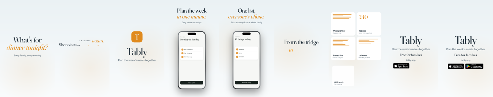
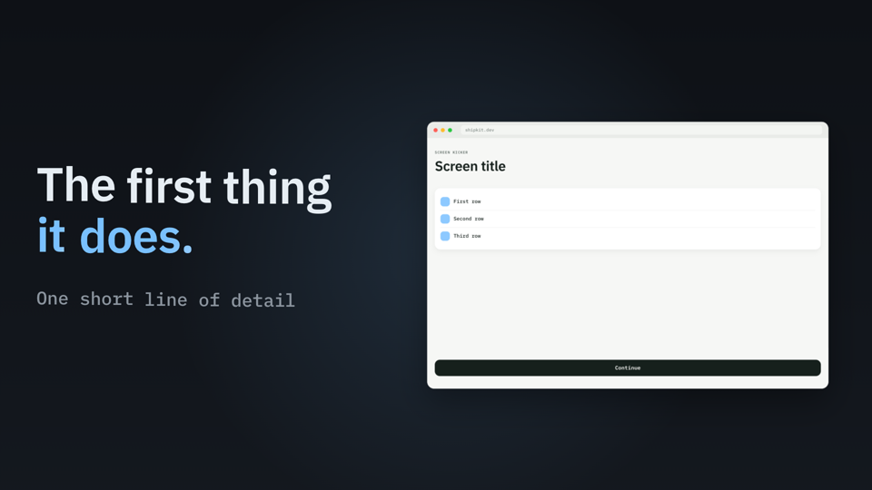

# launch-film: a Claude skill for launch videos

Ask Claude for a launch video and get a polished, beat-synced MP4: big type, your product on screen in 3D devices,
something happening on every beat, the drop landing on a feature wall, and an end card with store badges. Films are written
as code (one HTML page where every frame is a pure function of time) and rendered frame-exact in headless Chrome, so a copy
change is a re-render, not a re-edit.



## What it does
- **Vibes**: keynote (Apple-launch style), warm and human, playful pop, kinetic type, calm product UI, cinematic, lo-fi cozy,
  developer. Each one sets the tempo range, music, fonts, palettes, motion grammar, sound palette and scene structure.
- **Music by BPM**: give a tempo (or let the vibe pick one). It finds free Mixkit tracks, measures tempo, key and where each one
  lifts, keeps the ones that fit, and cuts previews the length of your film for you to listen to.
- **Reference videos**: give it a video file or link. It measures cut rhythm, tempo, pacing and palette, makes contact sheets
  for Claude to study, and turns them into a direction (borrowing rhythm and style, never the footage).
- **Beat-exact edit**: a kick-fitted beat grid, the song's biggest lift landed on your strongest scene, everything placed in bars.
- **Sound**: UI sounds synthesised in the song's key and levelled against the music; voice clips duck the music; -14 LUFS master.
- **Render**: 30 fps drafts, 60 fps finals with real motion blur, BT.709 H.264. 9:16, 4:5, 1:1 or 16:9.



## Install
In Claude Code:
```
/plugin marketplace add atuljha23/claude-motion-skill
/plugin install launch-film@claude-motion-skill
```
Or copy `skills/launch-film` to `~/.claude/skills/launch-film`.

Needs **Node 22+**, **ffmpeg** and **Google Chrome** (or Chromium). Optional: `yt-dlp` to analyse reference videos from a URL.

## Use
Just ask:
- "Make a 40 second Reels launch video for my app, Apple keynote style."
- "A warm promo for our language-learning app at about 95 BPM."
- "Make it feel like this: ~/Downloads/reference.mp4"
- "Find me music around 120 BPM for a playful launch video."

Claude asks a few questions (shape, vibe, music, sound, end card), lets you pick the music from previews, shows you stills before
the long render, then delivers the MP4 with a `BEATMAP.md` that explains every beat and how to rebuild it.

The scripts also work on their own:
```
node skills/launch-film/scripts/beat.mjs song.mp3 --land 16:11          # tempo, key, lifts; where to start the song
node skills/launch-film/scripts/music_search.mjs --bpm 100 --vibe warm   # shortlist + previews
node skills/launch-film/scripts/ref_video.mjs reference.mp4 --out ref    # style card + contact sheets
node skills/launch-film/scripts/new_film.mjs my-film --name "Acme" --vibe keynote --music song.mp3 --badges appstore,googleplay
```

## Add your own vibe or brand
Vibes are data in `skills/launch-film/assets/vibes.json`: copy an entry and change the tempo, music sources, Google fonts, colours
and motion. A brand kit is the same thing with your brand's colours and fonts.

## Licences
Music found by the search comes from [Mixkit](https://mixkit.co/license/#musicFree) under its Free Music Licence; check it fits
your use. Store badges are Apple's and Google's official artwork and must follow their guidelines. Fonts are from Google Fonts.
